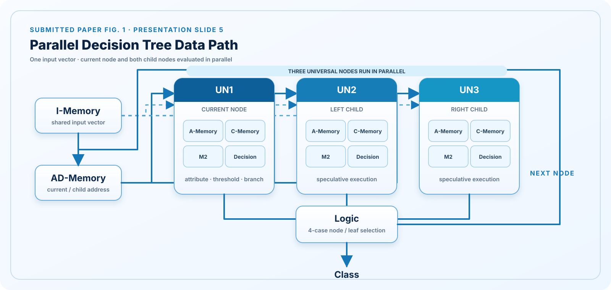
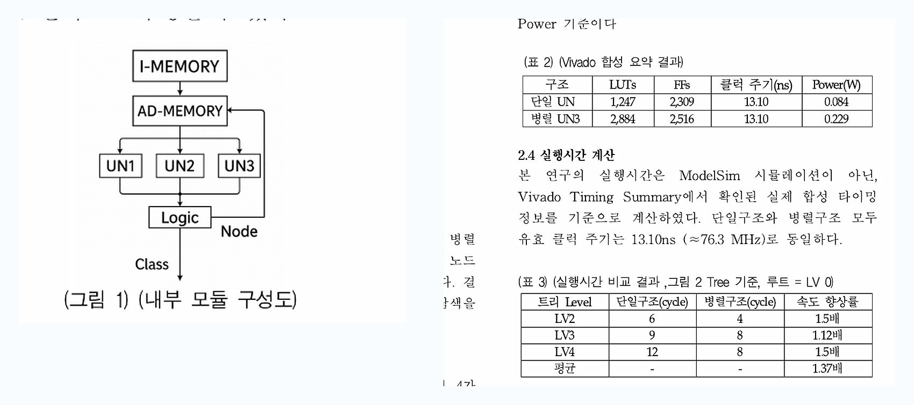
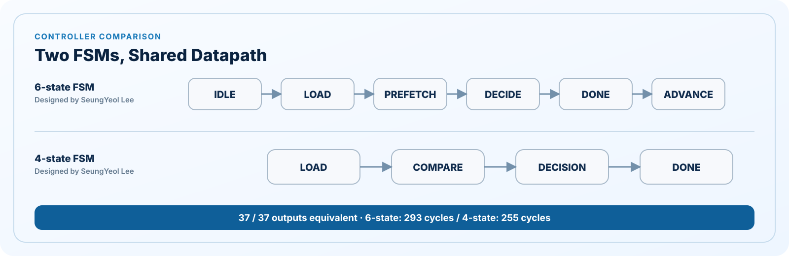

# Parallel Decision Tree Hardware

한 입력 벡터의 현재 노드와 좌·우 자식 노드를 병렬 계산하는 FPGA 결정트리 분류기입니다.


<a id="portfolio-navigation"></a>

## 개요

| 항목 | 내용 |
|---|---|
| 논문 | 병렬 구조 기반 결정트리 하드웨어 설계 및 분석 |
| 영문 제목 | Parallel Decision Tree Hardware Design and Analysis |
| 발표 | 2025.11.15 · 한국스마트미디어학회 추계학술대회 · 포스터 P2-14 |
| 저자 | SeungYeol Lee · Chung-Soo Lim |
| 기술 | Verilog · Vivado · Artix-7 · Icarus Verilog |


## 담당 역할

- 3-UN 병렬 Datapath와 탐색 제어 FSM 설계
- 6-state·4-state FSM을 모두 직접 구현하고 분류 결과·동등성 검사
- 논문 작성과 제1저자 학술대회 발표


## 설계·구현

<a id="research-contribution"></a>

### 병렬 탐색 구조

- 여러 입력을 동시에 처리하는 batch parallelism이 아니라, **한 입력 벡터 내부의 트리 탐색**을 병렬화했습니다.
- UN1이 현재 노드를 계산하는 동안 UN2·UN3이 좌·우 자식 노드를 미리 계산하는 speculative execution 구조입니다.
- 자식이 node/leaf인 네 가지 조합을 Logic이 판별해 다음 주소 또는 class를 선택합니다.
- 공유 I-Memory·AD-Memory와 동기 레지스터를 사용해 세 UN의 데이터 흐름을 정렬합니다.

<a id="architecture"></a>

### 시스템 구조

<p align="center">
  
</p>

**공유 메모리 → UN1·UN2·UN3 병렬 비교 → Logic 선택 → 다음 노드 피드백**으로 이어지는 데이터 흐름입니다.

- I-Memory의 동일 입력 벡터와 AD-Memory의 노드 주소를 UN1·UN2·UN3이 공유합니다.
- UN1은 현재 노드, UN2·UN3은 좌·우 자식 노드를 같은 구간에 계산합니다.
- Logic은 네 가지 node/leaf 조합을 판별해 class 또는 next node를 선택합니다.
- next node는 AD-Memory로 피드백되어 탐색을 반복합니다.

각 UN 내부는 A-Memory의 attribute/threshold, C-Memory의 child class 정보, M2 비교 연산부와 Decision 로직으로 구성됩니다.

<details>
<summary><strong>제출 논문의 원본 그림과 결과표 보기</strong></summary>
<br>
<p align="center">
  
</p>
<p>2025 한국스마트미디어학회 추계학술대회 제출 논문 2페이지의 그림 1, 표 2, 표 3 발췌본입니다. 병렬 구조와 합성·성능 결과를 확인할 수 있습니다.</p>
</details>

<a id="controller-implementations"></a>

### 탐색 제어 FSM

| Implementation | Control Flow | Role |
|---|---|---|
| [6-state FSM](./parallel-decision-tree/rtl/recovered_6state/top_prefetch_un3.v) | `IDLE → LOAD → PREFETCH → DECIDE → DONE → ADVANCE` | 직접 설계한 6-state 탐색 제어 |
| [4-state FSM](./parallel-decision-tree/rtl/refined_4state/top_prefetch_un3_4state.v) | `LOAD → COMPARE → DECISION → DONE` | 직접 설계한 4-state 탐색 제어 · 논문에 기재 |
| Submitted paper specification | `LOAD → COMPARE → DECISION → DONE` | 최종 제출 논문에 명시된 제어 흐름 |

두 버전은 I-Memory, AD-Memory, UN1–UN3, Logic으로 구성된 동일한 데이터패스를 공유합니다. 따라서 테스트에서는 각 FSM의 분류 결과와 완료 사이클을 동일한 조건에서 확인합니다.

<p align="center">
  
</p>

<a id="four-logic-cases"></a>

### Node/Leaf 선택

| Case | Left Child | Right Child | Logic Result |
|---:|---|---|---|
| 1 | Node | Node | 선택된 자식 주소로 탐색 계속 |
| 2 | Node | Leaf | 분기 방향에 따라 next node 또는 class |
| 3 | Leaf | Node | 분기 방향에 따라 class 또는 next node |
| 4 | Leaf | Leaf | class 확정 후 탐색 종료 |


## 검증 결과

<a id="paper-reported-fpga-results"></a>

### 논문의 합성·성능 결과

**결과 출처:** 2025 학술대회 논문 · Xilinx Artix-7 · Vivado · 순차 UN1/병렬 UN3 비교.

| Metric | Single UN | Parallel UN3 |
|---|---:|---:|
| LUT | 1,247 | 2,884 |
| FF | 2,309 | 2,516 |
| Clock period | 13.10 ns | 13.10 ns |
| Effective frequency | 약 76.3 MHz | 약 76.3 MHz |
| Total on-chip power | 0.084 W | 0.229 W |

| Tree Level | Single | Parallel | Speedup | Cycle Reduction |
|---|---:|---:|---:|---:|
| LV2 | 6 cycles | 4 cycles | 1.50× | 33.3% |
| LV3 | 9 cycles | 8 cycles | 1.12× | 11.1% |
| LV4 | 12 cycles | 8 cycles | 1.50× | 33.3% |
| Paper average | - | - | **1.37×** | - |

계산 기준과 논문 문구의 해석은 [Paper Reference](./parallel-decision-tree/docs/paper-reference.md)에 기록했습니다.

<a id="verification"></a>

### RTL 분류·동등성 검사

검증 항목:

1. 37-vector classification with the 6-state controller
2. Expected-class comparison and DONE-state assertion
3. 37-vector output equivalence between the 6-state and 4-state RTL
4. Batch completion-cycle comparison

<details>
<summary><strong>두 FSM의 37개 입력 벡터 검증</strong></summary>

6-state와 4-state는 모두 직접 설계한 제어 구현입니다. 동일한 Datapath와 입력으로 기능 동등성과 각 구현의 완료 사이클을 확인했습니다.

| Verification | Result |
|---|---:|
| 6-state FSM | **37 / 37 PASS** |
| 4-state FSM | **37 / 37 equivalent** |
| 6-state batch completion | **293 cycles** |
| 4-state batch completion | **255 cycles** |
| Regression | **GitHub Actions + Icarus Verilog** |

**측정 조건:** 동일 데이터패스 · 37개 입력 벡터 · 6-state/4-state FSM · Icarus Verilog.

</details>

<a id="verification-scope"></a>

### 결과별 실험 조건

| 결과 | 실험 조건 | 근거 |
|---|---|---|
| 논문 합성·병렬화 성능 | Vivado · Artix-7 · 순차 UN1 / 병렬 UN3 | 최종 학술대회 논문 |
| RTL 회귀 테스트 | Icarus Verilog · 37개 벡터 · 동일 데이터패스의 6-state / 4-state FSM | 저장소 자동 테스트 |
| 분류 데이터 | 결정적 AD/A/C/I-Memory 테이블 · 9개 leaf 경로 | 제어 흐름 검증용 회귀 데이터 |

<a id="conference-presentation"></a>

### 학술대회 발표

**2025 한국스마트미디어학회 추계학술대회 · 2025.11.15 · 포스터 P2-14 · 제1저자 발표**

<p align="center">
  
</p>

> **설계 범위:** 3-UN 병렬 Datapath와 6-state·4-state FSM을 모두 직접 설계했습니다. 최종 제출 논문은 `LOAD → COMPARE → DECISION → DONE`의 4-state 제어 흐름을 설명합니다.


## 실행 방법

### Icarus Verilog 실행

```bash
bash parallel-decision-tree/scripts/run_iverilog.sh
```


<a id="repository-structure"></a>

### 디렉터리

```text
parallel-decision-tree/
├── rtl/
│   ├── common/              # I-Memory, address, decision unit, selection logic
│   ├── recovered_6state/    # 6-state controller
│   └── refined_4state/      # 4-state controller used in the paper
├── tb/                      # 37-vector and equivalence tests
├── scripts/                 # Icarus Verilog regression
├── docs/                    # paper source and implementation basis
└── README.md                # detailed technical documentation
```

<a id="rtl-설계검증-자료"></a>

### 설계·검증 자료

RTL 구조와 입력 벡터 구성은 [설계·검증 자료](./parallel-decision-tree/docs/recovery-notes.md), 논문의 클록·비교 구조는 [실험 조건](./parallel-decision-tree/docs/paper-reference.md)에서 확인할 수 있습니다.

<a id="project-links"></a>

### 소스와 상세 문서

- [Detailed Project README](./parallel-decision-tree/README.md)
- [Paper Reference](./parallel-decision-tree/docs/paper-reference.md)
- [6-state RTL](./parallel-decision-tree/rtl/recovered_6state)
- [4-state RTL](./parallel-decision-tree/rtl/refined_4state)
- [Testbenches](./parallel-decision-tree/tb)
- [RTL 설계·검증 자료](./parallel-decision-tree/docs/recovery-notes.md)


[CI 실행 기록](https://github.com/lsy49055089/Parallel-Decision-Tree-Hardware/actions/workflows/verilog-ci.yml)

---

[웹 포트폴리오](https://seungyeol-rtl-portfolio.azuretide33.chatgpt.site) · [GitHub 프로필](https://github.com/lsy49055089)

[논문](https://github.com/lsy49055089/Parallel-Decision-Tree-Hardware) · [RTL / FPGA Design](https://github.com/lsy49055089/RTL-Design-Projects) · [Design Verification](https://github.com/lsy49055089/RTL-Verification-Projects) · [Embedded Systems](https://github.com/lsy49055089/Embedded-Systems-Projects) · [AI / CV](https://github.com/lsy49055089/AI-Projects)
