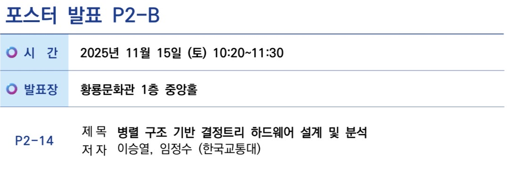

# Parallel Decision Tree Hardware

현재 노드와 좌·우 자식 노드를 함께 계산하는 3-UN Datapath와 탐색 제어 FSM을 설계했습니다.


<a id="portfolio-navigation"></a>

## 개요

| 항목 | 내용 |
|---|---|
| 발표 | 2025.11.15 · 한국스마트미디어학회 추계학술대회 · P2-14 |
| 기술 | Verilog · Vivado · Artix-7 · Icarus Verilog |


## 담당 역할

- 3-UN 병렬 Datapath, Node/Leaf 선택 Logic과 탐색 제어 FSM 설계
- 6-state·4-state 제어 구현, 37개 벡터의 분류 결과·동등성 검사
- 논문 작성과 제1저자 학술대회 발표


## 설계·구현

### 연구 아이디어

기존 batch-parallel 결정트리 하드웨어가 여러 입력 벡터를 병렬 처리하는 것과 달리, 이 설계는 **한 입력 벡터가 통과하는 노드 탐색 자체를 병렬화**합니다.

- UN1: 현재 노드 비교
- UN2: 왼쪽 자식 노드 사전 계산
- UN3: 오른쪽 자식 노드 사전 계산
- Logic: UN1의 분기 방향과 자식의 node/leaf 조합에 따라 next node 또는 class 선택

### 핵심 구조

- `I_Memory_ext`가 동일한 입력 벡터를 UN1~UN3에 공급합니다.
- `ad_ro`가 현재 노드와 두 자식 노드의 주소를 동시에 제공합니다.
- 각 `decision_tree` 인스턴스는 attribute/threshold와 class 정보를 사용해 비교·분기 결과를 계산합니다.
- `logic_param_prefetch`는 UN1의 방향에 따라 UN2 또는 UN3의 결과를 선택합니다.
- 선택 결과가 leaf이면 class를 출력하고, node이면 그 주소로 다음 병렬 탐색을 반복합니다.

### 논문의 네 가지 Logic Case

| Case | Left Child | Right Child | Result |
|---:|---|---|---|
| 1 | Node | Node | 선택된 자식 node로 탐색 계속 |
| 2 | Node | Leaf | next node 또는 class 선택 |
| 3 | Leaf | Node | class 또는 next node 선택 |
| 4 | Leaf | Leaf | class 확정 후 탐색 종료 |

### 탐색 제어 FSM 설계

최종 제출 논문은 `001 LOAD → 010 COMPARE → 011 DECISION → 100 DONE`의 네 상태를 명시합니다.

| 버전 | 상태 | 역할 |
|---|---|---|
| 6-state FSM | `IDLE · LOAD · PREFETCH · DECIDE · DONE · ADVANCE` | 직접 설계한 6-state 탐색 제어 |
| 4-state FSM | `LOAD · COMPARE · DECISION · DONE` | 직접 설계한 4-state 탐색 제어 · 논문에 기재 |

4-state 버전은 `active` 플래그로 LOAD 상태의 대기/실행 여부를 구분하지만 별도의 숨은 FSM 상태는 사용하지 않습니다. 분류 데이터패스와 Logic은 두 버전이 동일합니다.

### 향후 개선

- AD-Memory 주소 참조 구조를 개선해 논문의 4-cycle 탐색을 3-cycle로 단축
- 4개 이상의 UN으로 병렬 폭 확장
- Decision Tree Ensemble 또는 Random Forest 구조로 확장


## 검증 결과

### 논문에서 보고한 결과

**결과 출처:** 2025 학술대회 논문 · Xilinx Artix-7 · Vivado · 순차 UN1/병렬 UN3 비교.

| 항목 | 단일 UN | 병렬 UN3 |
|---|---:|---:|
| LUT | 1,247 | 2,884 |
| FF | 2,309 | 2,516 |
| 클록 주기 | 13.10 ns | 13.10 ns |
| 유효 주파수 | 약 76.3 MHz | 약 76.3 MHz |
| Total On-Chip Power | 0.084 W | 0.229 W |

| Tree Level | Single | Parallel | Speedup | Cycle Reduction |
|---|---:|---:|---:|---:|
| LV2 | 6 | 4 | 1.50× | 33.3% |
| LV3 | 9 | 8 | 1.12× | 11.1% |
| LV4 | 12 | 8 | 1.50× | 33.3% |
| 논문 평균 | - | - | 1.37× | - |

### RTL 분류·동등성 검사

테스트 항목:

1. `tb_top_prefetch_depth4_scenario`
   - 37개 입력 벡터 분류
   - 예상 class 일치 확인
   - `done`이 반드시 `state=100`에서만 발생하는지 확인
2. `tb_refined_4state_equivalence`
   - 6-state와 4-state의 37개 결과 전수 비교
   - 두 FSM의 분류 결과와 배치 완료 사이클 확인

GitHub Actions에서도 같은 회귀 테스트를 자동 실행합니다.

| Repository Regression | Result |
|---|---:|
| 6-state FSM | 37 / 37 PASS |
| 4-state FSM | 37 / 37 equivalent |
| 6-state batch completion | 293 cycles |
| 4-state batch completion | 255 cycles |

### 합성 기록의 구분

| Source | Tool / Target | Timing | Status |
|---|---|---|---|
| 최종 논문 | Vivado, Xilinx Artix-7 | 13.10 ns, WNS > 0 | 논문 보고값 |
| 과거 개발 로그 | Vivado 2023.2, `xc7a35tcpg236-1` | 10 ns target, WNS -3.083 ns | timing optimization 전 기록 |
| 현재 저장소 RTL | Icarus Verilog regression | functional simulation | Vivado 재합성 전 |

### 학술대회 발표

**2025 한국스마트미디어학회 추계학술대회 · 2025.11.15 · 포스터 P2-14 · 제1저자 발표**

<p align="center">
  
</p>


## 실행 방법

<a id="테스트"></a>

### Icarus Verilog 실행

Icarus Verilog가 설치된 Linux 환경에서 저장소 루트 기준으로 실행합니다.

```bash
bash parallel-decision-tree/scripts/run_iverilog.sh
```


### 구현 범위와 출처

공개 RTL의 구현 근거는 개발 기록과 최종 논문 명세입니다. 직접 설계한 6-state·4-state FSM은 공통 데이터패스를 사용하며, 최종 논문에는 4-state 제어 흐름을 기재했습니다.

- [논문 명세와 수치](docs/paper-reference.md)
- [현재 구현의 구성 근거](docs/recovery-notes.md)

### 디렉터리

```text
parallel-decision-tree/
├── rtl/
│   ├── common/
│   │   ├── I_Memory_ext.v
│   │   ├── ad_ro.v
│   │   ├── decision_tree.v
│   │   └── logic_param_prefetch.v
│   ├── recovered_6state/
│   │   └── top_prefetch_un3.v
│   └── refined_4state/
│       └── top_prefetch_un3_4state.v
├── tb/
│   ├── tb_top_prefetch_depth4_scenario.v
│   └── tb_refined_4state_equivalence.v
├── scripts/run_iverilog.sh
└── docs/
    ├── paper-reference.md
    └── recovery-notes.md
```


---

[웹 포트폴리오](https://seungyeol-rtl-portfolio.azuretide33.chatgpt.site) · [GitHub 프로필](https://github.com/lsy49055089)

[논문](https://github.com/lsy49055089/Parallel-Decision-Tree-Hardware) · [RTL / FPGA Design](https://github.com/lsy49055089/RTL-Design-Projects) · [Design Verification](https://github.com/lsy49055089/RTL-Verification-Projects) · [Embedded Systems](https://github.com/lsy49055089/Embedded-Systems-Projects) · [AI / CV](https://github.com/lsy49055089/AI-Projects)
